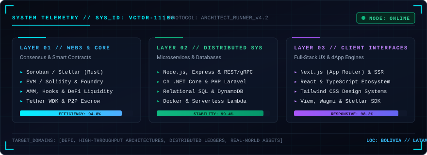

<div align="center">

  <!-- Language Switcher -->
  <p align="right">
    <code>Language:</code>
    <a href="#-versión-en-español"><b>🇪🇸 ES</b></a> | 
    <a href="#-english-version"><b>🇬🇧 EN</b></a>
  </p>

  # Víctor Hugo Murillo Siles
  ### Systems Engineer · Full Stack Tech Lead · Web3 & Distributed Architect

  <p align="center">
    <a href="https://linkedin.com/in/victor-murillo-siles"></a>
    <a href="https://github.com/Vctor11180"></a>
    <a href="mailto:victor.murillo.siles@gmail.com"></a>
  </p>

  <!-- High-Tech Shield Indicators -->
  <p align="center">
    
    
    
  </p>

</div>

---

<!-- SYSTEM HUD / TELEMETRY COMPONENT -->
<p align="center">
  
</p>

---

<a name="-versión-en-español"></a>
## 🇪🇸 Versión en Español

### ⚡ Perfil y Propuesta de Valor
Ingeniero de Sistemas y Tech Lead especializado en **arquitectura distribuida, protocolos Web3 y desarrollo full-stack de alto rendimiento**. Diseñado para competir y construir en entornos de alta exigencia (hackathons internacionales de Ethereum, Solana, Avalanche y Stellar), con experiencia directa en contratos inteligentes auditables, primitivas criptográficas físicas (NFC, zkTLS), agentes autónomos (MCP, Tether WDK) y sistemas concurrentes testeados para miles de usuarios.

---

### 🏆 1. Hackathons & Protocolos Web3 de Alto Impacto

Proyectos de competencia y soluciones de infraestructura descentralizada diseñadas para resolver problemas estructurales en economías emergentes y DeFi avanzada:

<table>
  <thead>
    <tr>
      <th width="32%">Proyecto & Ecosistema</th>
      <th width="48%">Desafío Técnico & Solución de Arquitectura</th>
      <th width="20%">Rol & Enlaces</th>
    </tr>
  </thead>
  <tbody>
    <tr>
      <td>
        <b>RoutePay Protocol</b><br/>
        <code>ETH Bolivia 2026</code><br/>
        <code>Avalanche Fuji</code> · <code>Tangem NFC</code> · <code>ERC-2771</code>
      </td>
      <td>
        <b>Problema:</b> Fletes internacionales con cobranza diferida (30-60 días) y riesgo de estafas en corredores comerciales (Arica - Bolivia).<br/>
        <b>Arquitectura:</b> Escrow criptográfico con meta-transacciones 100% gasless (ERC-2771 / ERC-2612) y liquidación instantánea sub-segundo activada por hardware físico <b>Tangem NFC</b> (EIP-712).
      </td>
      <td>
        <b>Frontend & Web3 Integration</b><br/>
        <a href="https://frontend-mu-bay-zvc6ih2zcs.vercel.app">🌐 Demo dApp</a><br/>
        <a href="https://github.com/RonaldGaymer2002/RoutePay">📂 Repositorio</a>
      </td>
    </tr>
    <tr>
      <td>
        <b>Casandra (oraculo-radiohead)</b><br/>
        <code>Aleph Hackathon 2026</code><br/>
        <code>Tether WDK Track</code> · <code>Sepolia</code> · <code>MCP Server</code>
      </td>
      <td>
        <b>Problema:</b> Agentes de IA en DeFi alucinando datos y ejecutando swaps sin evidencia verificable ni salvaguardas.<br/>
        <b>Arquitectura:</b> Substrato determinista de evidencia (Evidence Pack) para LLMs con servidor <b>Model Context Protocol (MCP)</b> vía stdio, guardarraíles con <b>Tether WDK</b> y registro on-chain en Ethereum Sepolia.
      </td>
      <td>
        <b>Smart Contracts & Web3 Core</b><br/>
        <a href="https://sepolia.etherscan.io/address/0x27544Fe45b81C09fC91f99c0A7374970839eC4FF">📜 Sepolia Contract</a><br/>
        <a href="https://github.com/RonaldGaymer2002/Casandra">📂 Repositorio</a>
      </td>
    </tr>
    <tr>
      <td>
        <b>Yalita Protocol</b><br/>
        <code>Avalanche Hackathon</code><br/>
        <code>zkTLS Reclaim</code> · <code>Foundry</code> · <code>Hono + Neon</code>
      </td>
      <td>
        <b>Problema:</b> +210M de latinoamericanos excluidos del crédito formal por falta de historial bancario tradicional.<br/>
        <b>Arquitectura:</b> Identidad financiera on-chain y scoring descentralizado mediante pruebas criptográficas <b>zkTLS</b> (extrayendo comprobantes QR de Tigo Money / SIMPLE sin APIs oficiales) con 4 contratos en Foundry y microservicios Hono.
      </td>
      <td>
        <b>Smart Contracts & Web3 Dev</b><br/>
        <a href="https://yalita-one.vercel.app/">🌐 Demo dApp</a><br/>
        <a href="https://github.com/RonaldGaymer2002/Yalita---Avalanche">📂 Repositorio</a>
      </td>
    </tr>
    <tr>
      <td>
        <b>Vibe Broker (sucha-tech)</b><br/>
        <code>Dev3pack Global</code> · <code>Solana Devnet</code><br/>
        <code>Anchor (Rust)</code> · <code>LI.FI</code> · <code>ElevenLabs TTS</code>
      </td>
      <td>
        <b>Problema:</b> Complejidad extrema de UX en DeFi (slippage, gas, firmas a ciegas) para usuarios no técnicos.<br/>
        <b>Arquitectura:</b> Asistente transaccional por voz/texto con ruteo cross-chain (LI.FI), confirmación por políticas de riesgo, síntesis de voz con ElevenLabs, recibos on-chain con <b>Anchor/Rust</b> y suite E2E "Gabezo" en Docker.
      </td>
      <td>
        <b>Co-Author & Contributor</b><br/>
        <a href="https://github.com/jackson1939/sucha-tech">📂 Repositorio</a>
      </td>
    </tr>
    <tr>
      <td>
        <b>CodoChain</b><br/>
        <code>Ideatón Stellar Fin de Año</code><br/>
        <code>Soroban (Rust)</code> · <code>RWA Factoring</code> · <code>Freighter</code>
      </td>
      <td>
        <b>Problema:</b> Falta de liquidez inmediata en PyMEs latinoamericanas por facturas con cobro a 90 días.<br/>
        <b>Arquitectura:</b> Marketplace de factoring tokenizado (RWA) sobre Stellar/Soroban con emisión de activos nativos, integración con Freighter Wallet y liquidación en USDC.
      </td>
      <td>
        <b>Lead Architect & Dev</b><br/>
        <a href="https://github.com/Vctor11180/Ideat-n---Arquisoft-Codochain">📂 Repositorio</a>
      </td>
    </tr>
    <tr>
      <td>
        <b>Vortex Protocol</b><br/>
        <code>EVM DeFi Engine</code><br/>
        <code>Solidity</code> · <code>Foundry</code> · <code>Hooks ERC-1155</code>
      </td>
      <td>
        <b>Problema:</b> Ineficiencia de capital y fees rígidos en AMMs ante alta volatilidad de mercado.<br/>
        <b>Arquitectura:</b> AMM modular optimizado con hooks de incentivo (ERC-1155), gestión dinámica de tarifas y Position Manager de bajo gas con ensamblador <code>extsload</code>.
      </td>
      <td>
        <b>Author & Architect</b><br/>
        <a href="https://vortexprotocol.vercel.app">🌐 Demo dApp</a><br/>
        <a href="https://github.com/Vctor11180/Vortex-Protocol">📂 Repositorio</a>
      </td>
    </tr>
  </tbody>
</table>

---

### 🚀 2. Aplicaciones Full-Stack & Concurrencia de Escala

Sistemas distribuidos de producción, aplicaciones móviles y plataformas colaborativas:

<table>
  <thead>
    <tr>
      <th width="30%">Producto</th>
      <th width="50%">Stack & Enfoque de Ingeniería</th>
      <th width="20%">Métricas & Enlaces</th>
    </tr>
  </thead>
  <tbody>
    <tr>
      <td>
        <b>Todo Ya</b><br/>
        <code>React Native</code> · <code>Expo v56</code><br/>
        <code>Neon DB (Postgres)</code> · <code>Gemini 2.5</code>
      </td>
      <td>
        Plataforma universal de servicios y licitación B2B/B2C en minutos. Arquitectura multi-tenant con Drizzle ORM, autenticación PIN/WhatsApp, KYC biométrico con <b>Gemini Vision</b> y motor de búsqueda semántica con IA de 2 niveles.
      </td>
      <td>
        <b>1.000+ Conexiones</b><br/>
        Optimizado para LATAM<br/>
        <a href="https://github.com/Todo-Yaa/TodoYa">📂 Repositorio</a>
      </td>
    </tr>
    <tr>
      <td>
        <b>Kosmovia</b><br/>
        <code>Stellar SDK</code> · <code>Next.js 14</code><br/>
        <code>Soroban Contracts</code> · <code>Fintech</code>
      </td>
      <td>
        Infraestructura de comunidades con billeteras no custodiales y pagos embebidos sobre la red Stellar, concebida para inclusión financiera y remesas de costo casi nulo en Bolivia.
      </td>
      <td>
        <a href="https://kosmovia.vercel.app">🌐 Demo en Vivo</a><br/>
        <a href="https://github.com/Vctor11180/kosmovia">📂 Repositorio</a>
      </td>
    </tr>
    <tr>
      <td>
        <b>Chaski (P2P Logistics)</b><br/>
        <code>Next.js</code> · <code>TypeScript</code> · <code>Escrow</code>
      </td>
      <td>
        Marketplace peer-to-peer de encomiendas colaborativas con contratos de custodia, sistema de reputación descentralizada y seguimiento de estados tolerante a fallos.
      </td>
      <td>
        <a href="https://chaski-app-smoky.vercel.app">🌐 Demo en Vivo</a><br/>
        <a href="https://github.com/Vctor11180/P2P-Marketplace-y-encomiendas">📂 Repositorio</a>
      </td>
    </tr>
    <tr>
      <td>
        <b>Aegis Engine</b><br/>
        <code>C# .NET Core</code> · <code>Laravel</code> · <code>Docker</code>
      </td>
      <td>
        Núcleo transaccional empresarial basado en Arquitectura Hexagonal y Domain-Driven Design (DDD), con aislamiento de dominios, esquemas SQL estrictos y pipelines de CI/CD.
      </td>
      <td>
        <a href="https://github.com/Vctor11180/Aegis">📂 Repositorio</a>
      </td>
    </tr>
  </tbody>
</table>

---

### 📝 3. Engineering Devlog & "Build in Public"

> *"La excelencia en ingeniería no se demuestra prometiendo en silencio, sino documentando rigurosamente cada trade-off técnico, cada post-mortem y cada decisión de diseño."*

Bitácora técnica basada en la filosofía minimalista de [Astro Micro](https://github.com/trevortylerlee/astro-micro) donde comparto aprendizajes reales del campo de batalla:

- 🔬 **[Post-Mortem: Meta-transacciones ERC-2771 con Hardware Tangem NFC en 48 Horas](https://github.com/RonaldGaymer2002/RoutePay)**: Cómo implementar firmas EIP-712 sin fricción en choferes de transporte pesado sin conocimiento cripto previo.
- 🔬 **[Agentes de IA Deterministas con Tether WDK y Servidores MCP](https://github.com/RonaldGaymer2002/Casandra)**: Por qué un LLM no debe operar swaps directamente y cómo diseñar un Evidence Pack con guardarraíles automáticos.
- 🔬 **[Extracción zkTLS sobre Redes de Pago Locales sin APIs Oficiales](https://github.com/RonaldGaymer2002/Yalita---Avalanche)**: Pruebas criptográficas de privacidad para validar solvencia financiera en Avalanche C-Chain.
- 🔬 **[DeFi Modular con Hooks y Optimización de Gas en Ensamblador (`extsload`)](https://github.com/Vctor11180/Vortex-Protocol)**: Lecciones construyendo creadores de mercado automatizados de nueva generación.

---

### 🛠️ Matriz de Arquitectura por Capas

```
┌────────────────────────────────────────────────────────────────────────┐
│ [01] PROTOCOL & WEB3  : Solidity (Foundry) · Soroban/Stellar (Rust)    │
│                         Solana (Anchor) · Tether WDK · Tangem NFC      │
│                         zkTLS (Reclaim) · Viem/Wagmi · ERC-2771 Gasless│
├────────────────────────────────────────────────────────────────────────┤
│ [02] BACKEND & DISTR. : Node.js · Express · C# .NET Core · PHP Laravel │
│                         Model Context Protocol (MCP) · REST & gRPC     │
├────────────────────────────────────────────────────────────────────────┤
│ [03] DATA & CLOUD     : PostgreSQL (Neon) · Drizzle ORM · Prisma       │
│                         Docker · AWS (Lambda, DynamoDB) · Vercel       │
├────────────────────────────────────────────────────────────────────────┤
│ [04] FRONTEND & APPS  : React Native (Expo v56) · Next.js 14/15        │
│                         React 18/19 · TypeScript · Tailwind CSS · GSAP │
└────────────────────────────────────────────────────────────────────────┘
```

---

<a name="-english-version"></a>
## 🇬🇧 English Version

### ⚡ Executive Summary & Value Proposition
Systems Engineer and Full-Stack Tech Lead specializing in **distributed architectures, Web3 protocols, and resilient software delivery**. Proven track record in high-velocity competitive environments (Ethereum, Solana, Avalanche, and Stellar hackathons), building audited smart contracts, physical cryptographic primitives (NFC, zkTLS), autonomous agent frameworks (MCP, Tether WDK), and concurrent systems engineered for thousands of users.

---

### 🏆 Featured Hackathons & Protocol Laurels

- **[RoutePay Protocol](https://github.com/RonaldGaymer2002/RoutePay)** *(ETH Bolivia 2026)* — Cross-border logistics escrow on Avalanche Fuji combining ERC-2771 gasless transactions with physical **Tangem NFC** hardware taps. *(Role: Frontend & Web3 Integration)*.
- **[Casandra](https://github.com/RonaldGaymer2002/Casandra)** *(Aleph Hackathon 2026 — Tether WDK Track)* — AI agent decision substrate utilizing an Anthropic **Model Context Protocol (MCP)** server, Tether WDK guardrails, and on-chain Sepolia anchoring. *(Role: Smart Contracts & Web3 Core)*.
- **[Yalita Protocol](https://github.com/RonaldGaymer2002/Yalita---Avalanche)** *(Avalanche Hackathon)* — Financial identity and decentralized credit scoring protocol using **zkTLS** (Reclaim Protocol) to extract QR payment records without centralized APIs. *(Role: Smart Contracts & Web3 Dev)*.
- **[Vibe Broker](https://github.com/jackson1939/sucha-tech)** *(Dev3pack Global Hackathon)* — Conversational voice-driven DeFi broker on Solana powered by **Anchor/Rust**, LI.FI cross-chain routing, ElevenLabs TTS, and Dockerized "Gabezo" E2E tests.
- **[CodoChain](https://github.com/Vctor11180/Ideat-n---Arquisoft-Codochain)** *(Stellar Year-End Ideathon)* — Tokenized RWA invoice factoring platform built on Stellar/Soroban with Freighter Wallet and USDC settlements.
- **[Vortex Protocol](https://github.com/Vctor11180/Vortex-Protocol)** — Modular DeFi AMM engine with ERC-1155 incentive hooks and assembly-level gas optimization via `extsload`.

---

### 📡 GitHub Diagnostic Telemetry

<div align="center">
  
  
</div>

---

### 📬 Connect & Collaborate

<p align="center">
  Building a Web3 protocol, high-throughput distributed system, or looking for an experienced Hackathon Tech Lead?<br/>
  <b>Let's build together:</b>
</p>

<p align="center">
  <a href="https://linkedin.com/in/victor-murillo-siles"></a>
  <a href="mailto:victor.murillo.siles@gmail.com"></a>
  <a href="https://github.com/Vctor11180"></a>
</p>

<p align="center">
  <sub>Architected with engineering discipline · Tested in production and hackathon battlegrounds</sub>
</p>
