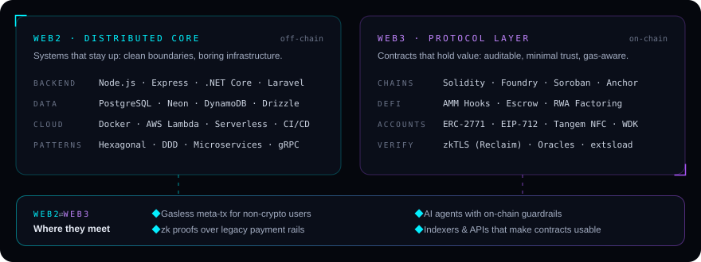

 

<a href="#-en-español">🇪🇸 Leer en español</a>

 

I build where **Web2 reliability** meets **Web3 trust** — hexagonal backends, serverless pipelines and data layers on one side; Solidity, Soroban and Anchor contracts on the other. Battle-tested across international hackathons on **Ethereum, Avalanche, Stellar and Solana**, mostly solving real problems for Latin America.

 

 

##  Protocols & hackathons

<table>
  <tr>
    <td width="50%" valign="top">
      <b><a href="https://github.com/RonaldGaymer2002/RoutePay">RoutePay Protocol</a></b> 
      <code>ETH Bolivia 2026</code> · Avalanche Fuji · ERC-2771 · Tangem NFC
      
Gasless cross-border freight escrow with sub-second settlement triggered by a physical NFC tap.

      Frontend & Web3 Integration · <a href="https://frontend-mu-bay-zvc6ih2zcs.vercel.app">Demo ↗</a>
    </td>
    <td width="50%" valign="top">
      <b><a href="https://github.com/RonaldGaymer2002/Casandra">Casandra</a></b> 
      <code>Aleph Hackathon 2026 · Tether WDK</code> · MCP · Sepolia
      
Deterministic evidence layer so DeFi AI agents can't act on hallucinated data — MCP server + WDK guardrails.

      Smart Contracts & Web3 Core · <a href="https://sepolia.etherscan.io/address/0x27544Fe45b81C09fC91f99c0A7374970839eC4FF">Contract ↗</a>
    </td>
  </tr>
  <tr>
    <td width="50%" valign="top">
      <b><a href="https://github.com/RonaldGaymer2002/Yalita---Avalanche">Yalita Protocol</a></b> 
      <code>Avalanche Hackathon</code> · zkTLS (Reclaim) · Foundry · Hono
      
On-chain credit identity for the 210M+ unbanked in LATAM, proven from local payment receipts via zkTLS.

      Smart Contracts & Web3 Dev · <a href="https://yalita-one.vercel.app/">Demo ↗</a>
    </td>
    <td width="50%" valign="top">
      <b><a href="https://github.com/jackson1939/sucha-tech">Vibe Broker</a></b> 
      <code>Dev3pack Global</code> · Solana · Anchor · LI.FI
      
Voice-driven DeFi assistant with cross-chain routing, risk-policy confirmations and on-chain receipts.

      Co-Author & Contributor
    </td>
  </tr>
  <tr>
    <td width="50%" valign="top">
      <b><a href="https://github.com/Vctor11180/Ideat-n---Arquisoft-Codochain">CodoChain</a></b> 
      <code>Stellar Ideathon</code> · Soroban (Rust) · RWA · USDC
      
Tokenized invoice factoring so LATAM SMEs get liquidity today instead of in 90 days.

      Lead Architect & Dev
    </td>
    <td width="50%" valign="top">
      <b><a href="https://github.com/Vctor11180/Vortex-Protocol">Vortex Protocol</a></b> 
      <code>EVM DeFi Engine</code> · Solidity · ERC-1155 hooks · extsload
      
Modular AMM with incentive hooks, dynamic fees and an assembly-optimized Position Manager.

      Author & Architect · <a href="https://vortexprotocol.vercel.app">Demo ↗</a>
    </td>
  </tr>
</table>

##  Products & distributed systems

<table>
  <tr>
    <td width="50%" valign="top">
      <b><a href="https://github.com/Todo-Yaa/TodoYa">Todo Ya</a></b> 
      React Native · Expo · Neon Postgres · Drizzle · Gemini
      
Multi-tenant services marketplace with WhatsApp/PIN auth, biometric KYC and two-tier AI search.

      <b>1,000+ connections</b> · built for LATAM
    </td>
    <td width="50%" valign="top">
      <b><a href="https://github.com/Vctor11180/kosmovia">Kosmovia</a></b> web2 ⇄ web3 
      Next.js · Stellar SDK · Soroban
      
Community infrastructure with non-custodial wallets and near-zero-cost payments for Bolivia.

      <a href="https://kosmovia.vercel.app">Demo ↗</a>
    </td>
  </tr>
  <tr>
    <td width="50%" valign="top">
      <b><a href="https://github.com/Vctor11180/P2P-Marketplace-y-encomiendas">Chaski</a></b> web2 ⇄ web3 
      Next.js · TypeScript · Escrow
      
P2P parcel-delivery marketplace with escrowed payments, reputation and fault-tolerant tracking.

      <a href="https://chaski-app-smoky.vercel.app">Demo ↗</a>
    </td>
    <td width="50%" valign="top">
      <b><a href="https://github.com/Vctor11180/Aegis">Aegis Engine</a></b> 
      C# .NET Core · Laravel · Docker · CI/CD
      
Hexagonal, DDD-based transactional core with isolated domains and strict SQL schemas.

    </td>
  </tr>
</table>

## Devlog · build in public

- **[ERC-2771 meta-transactions with Tangem NFC in 48 hours](https://github.com/RonaldGaymer2002/RoutePay)** — frictionless EIP-712 signing for truck drivers with zero crypto background.
- **[Deterministic AI agents with Tether WDK and MCP](https://github.com/RonaldGaymer2002/Casandra)** — why an LLM should never swap directly.
- **[zkTLS over local payment rails without official APIs](https://github.com/RonaldGaymer2002/Yalita---Avalanche)** — privacy-preserving proofs of solvency.
- **[Modular DeFi with hooks and assembly-level gas tuning](https://github.com/Vctor11180/Vortex-Protocol)** — lessons from a next-gen AMM.

## Telemetry

  
  

 

  <b>Building a protocol, a high-throughput system, or need a hackathon tech lead?</b> 
  <a href="https://vctor11180.vercel.app">Open the portfolio</a> · <a href="mailto:victormurillor6@gmail.com">victormurillor6@gmail.com</a>

 

---

<b>🇪🇸 En español</b>

 

Ingeniero de Sistemas y Tech Lead Full Stack. Construyo donde la **confiabilidad Web2** se encuentra con la **confianza Web3**: backends hexagonales, pipelines serverless y capas de datos por un lado; contratos en Solidity, Soroban y Anchor por el otro. Experiencia en hackathons internacionales de **Ethereum, Avalanche, Stellar y Solana**, resolviendo problemas reales de Latinoamérica.

**Destacados**

- **RoutePay** *(ETH Bolivia 2026)* — escrow de fletes sin gas, con liquidación instantánea mediante tap NFC Tangem.
- **Casandra** *(Aleph Hackathon 2026)* — evidencia determinista para agentes de IA en DeFi con MCP y Tether WDK.
- **Yalita** *(Avalanche)* — identidad crediticia on-chain con pruebas zkTLS sobre pagos locales.
- **CodoChain** *(Ideatón Stellar)* — factoring tokenizado (RWA) para PyMEs sobre Soroban.
- **Todo Ya** — marketplace de servicios con KYC biométrico e IA, 1.000+ conexiones.

¿Construyes un protocolo o necesitas un tech lead para tu hackathon? → [Portafolio](https://vctor11180.vercel.app) · [Email](mailto:victormurillor6@gmail.com)

